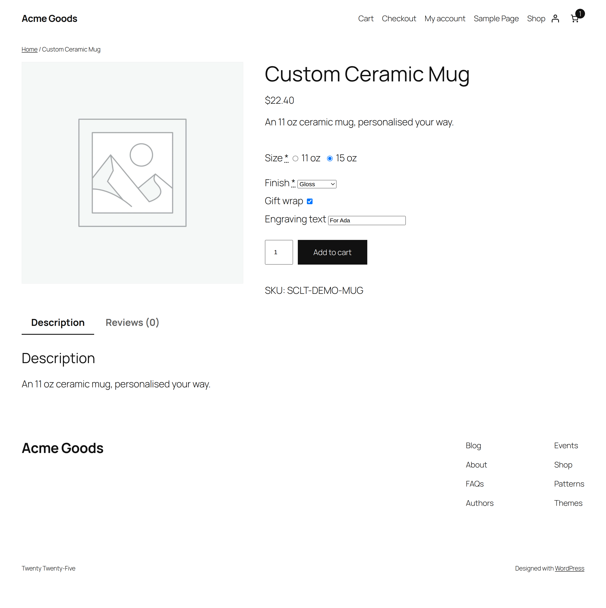
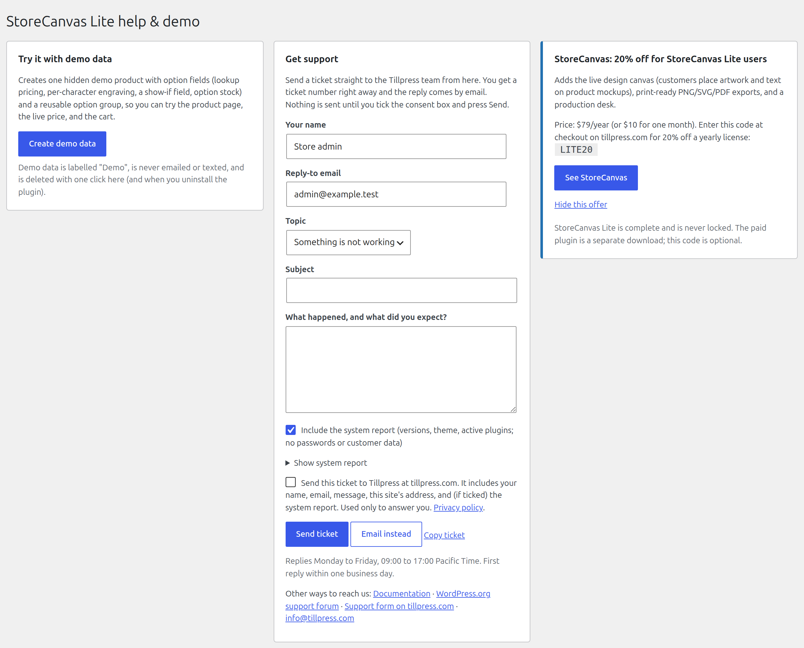
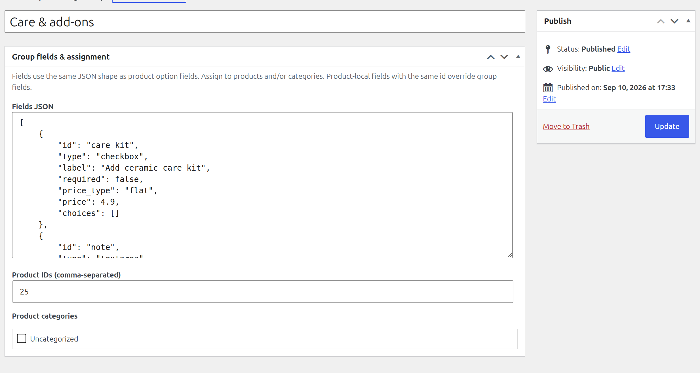
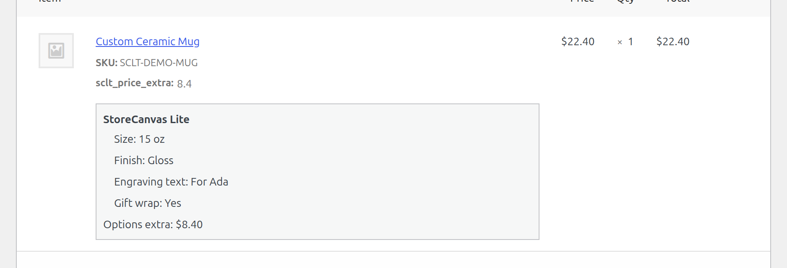

# StoreCanvas Lite

**Free WooCommerce product options and a customer design canvas** — 15 field types, conditional logic, pricing, option stock, and text/photo designs on one print area.

No license key, no account, no license checks or telemetry. Free forever. Tillpress is contacted only when you choose to send a support ticket; see the support details below.

- 15 field types: dropdown, radio, checkbox, multi-select, short text, long text, email, phone, phone (tel), number, date, color, image choice, file upload, section heading
- Pricing: flat fee, percent of the product price, per quantity, per character, per-choice lookup table (negative amounts are discounts)
- Live price preview on the product page (classic and block themes)
- Multi-rule show/hide conditions (AND/OR)
- Per-choice option stock
- Quantity discounts: up to 10 tiers per product, such as "10 or more, 10% off each", with a "Buy more, pay less" table on the product page
- Reusable option groups (assign by product or category)
- Customer design canvas: one print area on the product's main image, text with bundled fonts, and PNG/JPEG photos
- Move, resize, rotate and reorder design layers; order previews and original uploaded photos stay on your site

Paid [StoreCanvas](https://tillpress.com/storecanvas/) adds multiple product views and print areas, clipart, templates, print-ready PNG/SVG/PDF exports, and production workflow. Lite includes its own design canvas and options engine, with no license key or time limit.

Author: [Tillpress](https://tillpress.com) (trade name of Alex Software Holdings LLC). Contact: info@tillpress.com.

## Install

Easiest: in wp-admin go to **Plugins → Add New**, search for **StoreCanvas Lite**, then install and activate. It is listed at [wordpress.org/plugins/storecanvas-lite](https://wordpress.org/plugins/storecanvas-lite/). WooCommerce must already be active. Then edit a product → **StoreCanvas Lite** tab, or go to **Products → Option groups**.

Installing from this repo instead? Extract GitHub's source archive, rename the plugin folder to `storecanvas-lite`, then re-zip that folder for upload or copy it into `wp-content/plugins/`. The WordPress.org ZIP is ready to upload.

Requirements: WordPress 6.2+, PHP 7.4+, WooCommerce 7.0+.

## Setup

### 1. Add fields on one product

1. Edit a WooCommerce product.
2. Open the **StoreCanvas Lite** tab.
3. Add a field (for example a dropdown “Size”).
4. Set a price if needed. Per-choice prices are written as `Large=10` (one per line).
5. Update the product.
6. View the product on the storefront. The live price should match what you configured.

### 2. Reuse fields on many products

1. Go to **Products → Option groups**.
2. Create a group and add fields.
3. Assign the group to product IDs and/or product categories.
4. You can still add product-local fields. A local field with the same id overrides the group field.

### 3. Conditional fields

On a field, add show-if rules. Multiple rules support AND/OR. Operators: is, is not, contains, does not contain, greater/less than (or equal), empty, not empty, in-list.

Conditional fields work with classic and block themes. See [readme.txt](readme.txt) for the full setup guide and changelog.

### 4. Option stock

On dropdown, radio, multi-select, or image-choice, give a choice a stock quantity. Sold-out choices are disabled. Stock decrements when an order is placed and restores if the order is cancelled or fails. On a refund, stock returns for the refunded quantity only when you tick **Restock refunded items**.

### 5. Quantity discounts

In the product's **StoreCanvas Lite** tab, under **Quantity discounts**, fill a row per tier: the quantity it starts at (2 or more), the discount, and % off or an amount off each item. The quantity counts every item of that product in the cart, in any option or size, and the discount applies to the full item price including options.

### 6. What the customer sees on the order

Choices and the options total show on the order screen, in emails, and on the confirmation.

### 7. Customer design canvas

1. Set a main (featured) image on the product.
2. Open its **StoreCanvas Lite** tab, find **Customer design canvas**, and tick **Let customers design this product**.
3. Drag the print-area box on the image, or enter its position and size.
4. Choose whether a design is required, whether customers may upload photos, the maximum number of layers, and any design fee. Update the product.

Customers can add text and PNG/JPEG photos, then move, resize, rotate and reorder layers inside that print area. The design preview appears in the cart, checkout, order emails and My Account. The admin order screen provides the preview and original uploaded photos for download.

Designs are stored on your own site. See [readme.txt](readme.txt) → Privacy for access controls, retention and what happens to design files on uninstall.

## Screenshots

## FAQ

### Is there a license key or trial?

No. Lite's options and design canvas do not require a license key or a trial.

### How does pricing work?

Each field can add a flat fee, a percent of the product (or selected variation) price, an amount × quantity, an amount per character, or a per-choice lookup price. Negative amounts are discounts. The unit price never drops below zero.

### What if I also install paid StoreCanvas?

Lite steps aside while the paid StoreCanvas plugin is activated, even if its Pro entitlement has ended. There is no automatic switch to Lite on expiry. To use Lite's features instead, deactivate the paid plugin and activate Lite; configure the product's Lite options and canvas as needed.

### Can I install from “Code → Download ZIP”?

Extract the archive, rename the plugin folder to `storecanvas-lite`, then re-zip that folder or copy it into `wp-content/plugins/`. The simpler route is installing from WordPress.org.

### WooCommerce options panel looks broken?

WooCommerce’s `.woocommerce_options_panel` floats labels into a 150px column. Lite resets float/width inside its builder. If a third-party CSS file fights that, say so when you write in.

### Where do I get help?

Open **Products → StoreCanvas Lite help**, use the [WordPress.org support forum](https://wordpress.org/support/plugin/storecanvas-lite/), or email **info@tillpress.com**.

The optional support form contacts Tillpress only after you tick the consent box and press **Send ticket**. It sends your name, reply address, topic, subject, message and site URL, plus a system report if selected. The generated report lists versions, theme and active plugins without credentials or customer/order data. See [readme.txt](readme.txt) → External services for the endpoint and privacy policy.

## License

GPLv2 or later. See [LICENSE](LICENSE).
