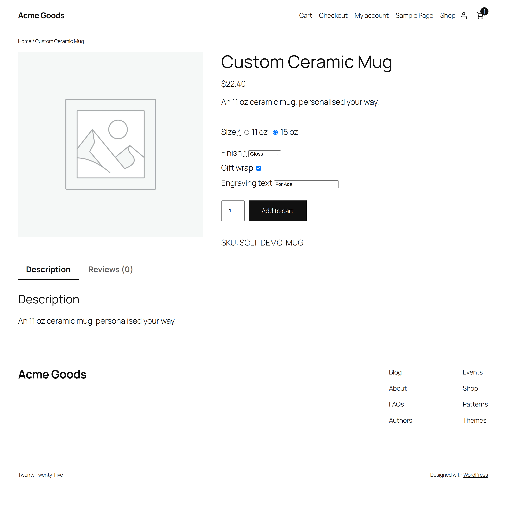
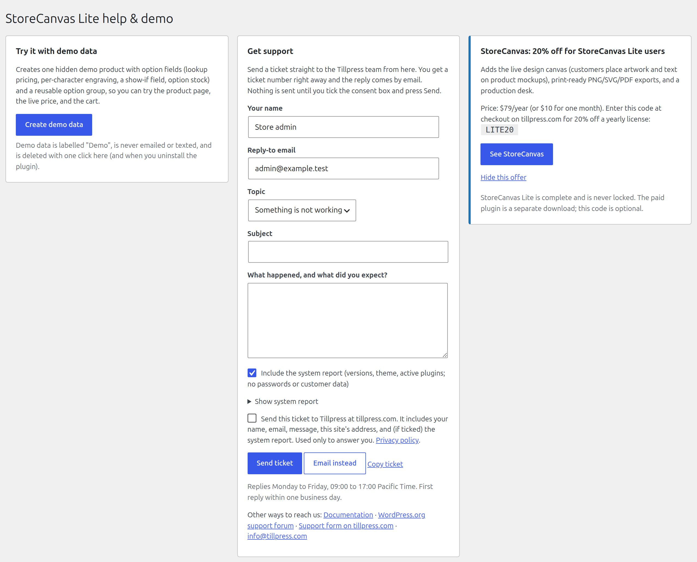
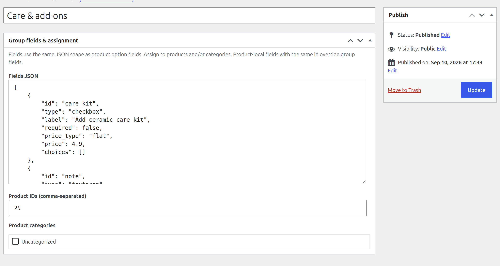
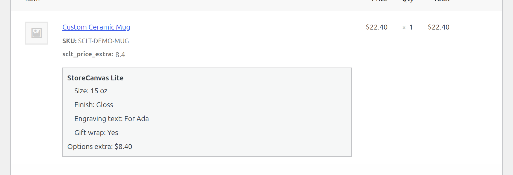

# StoreCanvas Lite

**Free WooCommerce product options** — 15 field types, conditional logic, pricing, and option stock.

No license key, no account, no phone-home. Free forever.

- 15 field types: dropdown, radio, checkbox, multi-select, short text, long text, email, phone, phone (tel), number, date, color, image choice, file upload, section heading
- Pricing: flat fee, percent of the product price, per quantity, per character, per-choice lookup table (negative amounts are discounts)
- Live price preview on the product page (classic and block themes)
- Multi-rule show/hide conditions (AND/OR)
- Per-choice option stock
- Quantity discounts: up to 10 tiers per product, such as "10 or more, 10% off each", with a "Buy more, pay less" table on the product page
- Reusable option groups (assign by product or category)

Paid [StoreCanvas](https://tillpress.com/storecanvas/) adds the live design canvas (customers place artwork and text on mockups), print-ready exports, and production workflow. Lite is the options engine only and is never locked.

Author: [Tillpress](https://tillpress.com) (trade name of Alex Software Holdings LLC). Contact: info@tillpress.com.

## Install

Easiest: in wp-admin go to **Plugins → Add New**, search for **StoreCanvas Lite**, then install and activate. It is listed at [wordpress.org/plugins/storecanvas-lite](https://wordpress.org/plugins/storecanvas-lite/). WooCommerce must already be active. Then edit a product → **StoreCanvas Lite** tab, or go to **Products → Option groups**.

Installing from this repo instead? WordPress needs a folder named `storecanvas-lite`, and GitHub’s “Source code” zip is named `storecanvas-lite-main`, so rename the folder before uploading it (or use the wordpress.org zip).

Requirements: WordPress 6.2+, PHP 7.4+, WooCommerce 7.0+.

## Setup

### 1. Add fields on one product

1. Edit a WooCommerce product.
2. Open the **StoreCanvas Lite** tab.
3. Add a field (for example a dropdown “Size”).
4. Set a price if needed. Per-choice prices are written as `Large=10` (one per line).
5. Update the product.
6. View the product on the storefront. The live price should match what you configured.

### 2. Reuse fields on many products

1. Go to **Products → Option groups**.
2. Create a group and add fields.
3. Assign the group to product IDs and/or product categories.
4. You can still add product-local fields. A local field with the same id overrides the group field.

### 3. Conditional fields

On a field, add show-if rules. Multiple rules support AND/OR. Operators: is, is not, contains, does not contain, greater/less than (or equal), empty, not empty, in-list.

On block themes (Twenty Twenty-Five and similar), 1.0.1 is required — 1.0.0 show-if did not run there.

### 4. Option stock

On dropdown, radio, multi-select, or image-choice, give a choice a stock quantity. Sold-out choices are disabled. Stock decrements when an order is placed and restores if the order is cancelled or fails.

### 5. Quantity discounts

In the product's **StoreCanvas Lite** tab, under **Quantity discounts**, fill a row per tier: the quantity it starts at (2 or more), the discount, and % off or an amount off each item. The quantity counts every item of that product in the cart, in any option or size, and the discount applies to the full item price including options.

### 6. What the customer sees on the order

Choices and the options total show on the order screen, in emails, and on the confirmation. If you still see raw `sclt_price_extra`, you are on 1.0.0 — install 1.0.1.

## Screenshots

## FAQ

### Is there a license key or trial?

No. Every Lite feature works without a key, trial, or phone-home.

### How does pricing work?

Each field can add a flat fee, a percent of the product (or selected variation) price, an amount × quantity, an amount per character, or a per-choice lookup price. Negative amounts are discounts. The unit price never drops below zero.

### What if I also install paid StoreCanvas?

Lite steps aside so you do not get duplicate fields or double charges. You can deactivate Lite.

### Can I install from “Code → Download ZIP”?

Only if you rename the unzipped folder to `storecanvas-lite` first. The simpler route is installing from wordpress.org.

### WooCommerce options panel looks broken?

WooCommerce’s `.woocommerce_options_panel` floats labels into a 150px column. Lite resets float/width inside its builder. If a third-party CSS file fights that, say so when you write in.

### Where do I get help?

Email **info@tillpress.com**. Paid canvas product: [tillpress.com/storecanvas](https://tillpress.com/storecanvas/).

## License

GPLv2 or later. See [LICENSE](LICENSE).
